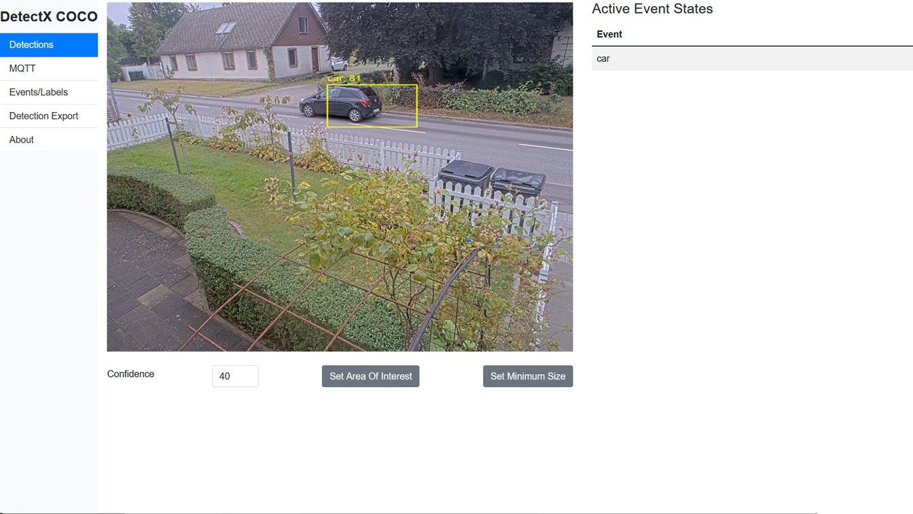
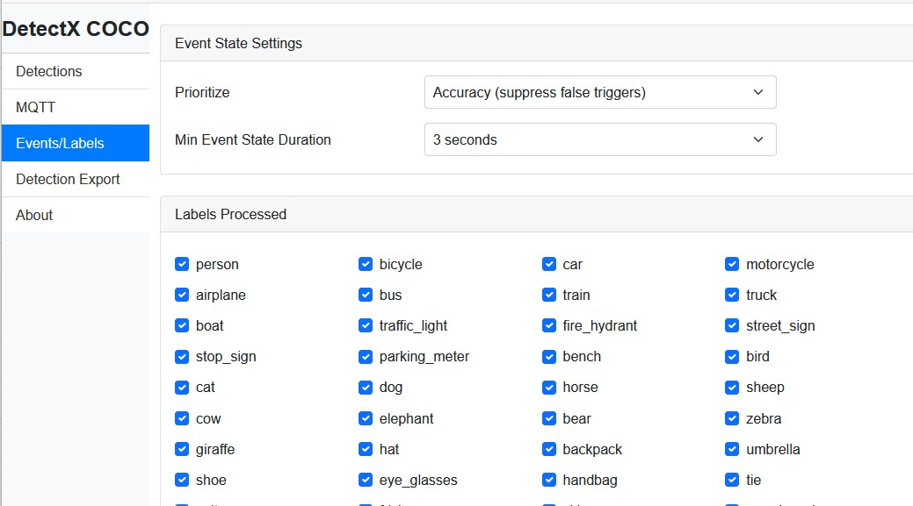
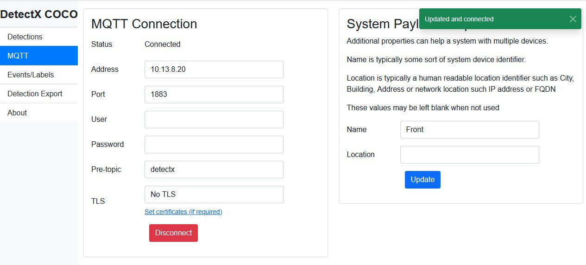
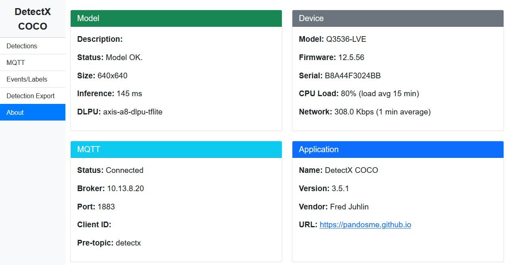

# HandGesture

On-camera hand gesture recognition for Axis cameras with **ARTPEC-8** and **ARTPEC-9**
chipsets. Detections are published over MQTT, ONVIF events and HTTP for
machine-to-machine use.

HandGesture is a variation of [DetectX](https://github.com/pandosme/DetectX). Where
DetectX runs one model per frame, HandGesture runs **two**, and that difference is
what gives it range.

---

## How the detection works

Recognising a gesture is really two different problems, and they want opposite things
from an image.

* **Finding a hand** needs resolution, not depth. A hand is a distinctive blob; a small
  network finds it reliably even when it is only a handful of pixels across.
* **Reading a gesture** needs detail, not field of view. Telling `three` from `four`
  means resolving individual fingers.

A single model has to compromise between the two. HandGesture splits them:

```
   camera                     camera
   960x544 stream             largest 16:9 stream (e.g. 3840x2160)
        │                          │
        ▼                          │
   ┌──────────────────────────┐    │
   │ STAGE 1 - hand detector  │    │   YOLOv8n, 1 class, 960x544
   │ "where are the hands?"   │    │   anchor-free, 10 710 anchors
   └──────────────────────────┘    │
        │  0-N boxes               │
        ▼                          ▼
   crop each hand from the FULL-RESOLUTION frame,
   square, 1.25x margin, area-resampled to 128x128
        │
        ▼
   ┌──────────────────────────┐
   │ STAGE 2 - classifier     │   YOLOv8s-cls, 15 gestures, 128x128
   │ "which gesture is it?"   │   runs once per detected hand
   └──────────────────────────┘
        │
        ▼
   best gesture >= threshold ?  ->  gesture        (e.g. "peace")
                       else     ->  fallback label  ("no_gesture")
        │
        ▼
   MQTT / ONVIF / HTTP
```

Stage 2 sees a crop scaled so the hand fills the frame, the same view the classifier was
trained on, however far away the person is. The crop comes from a second video stream at
the camera's largest 16:9 resolution (limited to the active capture mode), not from the
detector's 960x544 input: a hand that is 15 px wide to the detector is 60 px of real
detail on a 4K camera. Without that stream (it fails to start), stage 2 falls back to the
detector frame.

Stage 2 runs **after** non-maximum suppression, so each surviving hand is classified
exactly once, and only when a hand is present.

Each detection carries the gesture in `label` and its confidence in `c`. The detector's
score is kept as `hand_c`, and when the threshold rule replaced the label, the
classifier's best guess is added as `gesture`/`gesture_c`, so you can tell "sure it is a hand, unsure
which gesture" from "unsure there is a hand at all".

### Recognised gestures

15 gestures, chosen for being distinct and useful:

```
call      dislike   fist      four      like
mute      ok        one       palm      peace
rock      stop      three     middle_finger
no_gesture
```

Dropped in 5.0 as rarely used and easily confused: `peace_inverted`, `stop_inverted`,
`three2`, `two_up`, `two_up_inverted`.

`no_gesture` is the rejection class: relaxed hands, hands holding something, and false
hand detections (an elbow with the back turned, a leg). On top of it, the **gesture
threshold** (default 60 %) turns any hand whose best gesture scores lower into
`no_gesture`, so an uncertain hand never fires a gesture event.

### Range

Range is set by how many pixels the hand covers. Measured on real camera data
(the author's cameras, int8 models, decoded like the camera):

**Stage 1 — finding the hand** (960x544 input, confidence 30 %, test split of 1 136 hands):

| hand width at the 960x544 input | 6-10 px | 10-16 px | 16-24 px | 24-40 px | 40+ px |
|---|---|---|---|---|---|
| found | 0.82 | 0.86 | 0.96 | 0.97 | 1.00 |

From about **16 px at the model input** a hand is found reliably: ~64 px on a 4K camera,
~45 px at 2688x1512. Smaller hands are often found, but with coarse boxes.

**Stage 2 — reading the gesture** (445 held-out real hands from an indoor and an outdoor
camera, crops cut like the camera does):

| | exact boxes | camera-like box errors |
|---|---|---|
| ARTPEC-9 int8 | 96.2 % | 93.7 % |
| ARTPEC-8 int8 | 94.6 % | 93.5 % |

Weakest: `fist` (read as `one` or `no_gesture`) and `three` (read as `peace`). A gesture
is held for about a second, so several frames vote, and the event stabilisation turns that
into a stable event.

**Limits:** stage 1 boxes are int8-quantised to steps of 3.76 px at the 960x544 input
(about 15 px on a 4K frame). On far hands the box can sit beside the hand, which is the
main source of wrong gestures at distance. The training data is one person on two
cameras; expect lower accuracy for other people and viewpoints until more data is added.

---

## Performance

| Chip | Hand detector (960x544) | Both stages |
|---|---|---|
| ARTPEC-8 (office camera, 2688x1512) | — | **~95 ms** without hands, **~110 ms** with one hand |
| ARTPEC-9 (4K camera) | ~42 ms (hand detector alone) | not yet measured |

The target is 5 frames/s for both stages. Stage 2 adds one 128x128 inference per hand.

---

## Requirements

* Axis camera with ARTPEC-8 or ARTPEC-9 and a DLPU
* **ARTPEC-9 requires Axis OS 13 or later.** Earlier firmware miscomputes YOLOv8 on the
  A9 DLPU: the model loads and runs at full speed but returns high-confidence garbage,
  while the identical package is correct on ARTPEC-8.

### The two packages are not interchangeable

ARTPEC-8 requires **per-tensor** weight quantization; ARTPEC-9 uses **per-channel**.
Install the package that matches the chip:

| Package | Chip |
|---|---|
| `HandGesture_<version>_artpec8.eap` | ARTPEC-8 |
| `HandGesture_<version>_artpec9.eap` | ARTPEC-9 |

---

## Quick start

### Install a pre-built package

Upload the `.eap` for your chip through the camera web interface:
**Settings → Apps → Add**, then Start. Or:

```sh
export AXIS_USER=youruser
read -rs AXIS_PASS && export AXIS_PASS
./install.sh <camera-host> a8      # or a9
```

### Build from source

```sh
./build.sh                 # both chips
./build.sh --target a8     # one chip
```

Builds run in Docker with the Axis ACAP SDK and produce one `.eap` per chip. Model
parameters — input size, tensor shapes, quantization scales — are extracted from the
TFLite files at build time, so nothing needs editing by hand.

---

## Models

Packaged, ready to run:

| File | Purpose | Input | Output |
|---|---|---|---|
| `app/model/model-a8.tflite` / `-a9` | stage 1 hand detector (Hands v4) | `[1,544,960,3]` uint8 | `[1,4,10710]` + `[1,1,10710]` uint8 |
| `app/model/gesture-a8.tflite` / `-a9` | stage 2 classifier (gesture15) | `[1,128,128,3]` uint8 | `[1,15]` uint8 |

Both are full-INT8 with uint8 input and output; ARTPEC-8 per-tensor, ARTPEC-9 per-channel.
The detector emits **two** tensors, coordinates and scores separately — see
[docs/MODEL_QUANTIZATION.md](docs/MODEL_QUANTIZATION.md).

### Model checkpoints

The PyTorch checkpoints are in [`models/`](models/), described in
[models/README.md](models/README.md):

| File | |
|---|---|
| `models/stage1_hand_yolov8n.pt` | Hands v4: YOLOv8n trained at 960 on real camera frames + HaGRID |
| `models/stage2_gesture_yolov8s_cls.pt` | gesture15: YOLOv8s-cls 128, HaGRID + real camera hands |

**Training is not part of this repository.** HandGesture is the application.

---

## Configuration



**Detections** — live view with bounding boxes, hand confidence, **gesture threshold**
and **below-threshold label** (default 60 % and `no_gesture`), and area of interest.
There is no minimum-size filter: hands are small by nature.

**Events/Labels** — which gestures fire events, and how strict the trigger is
("Prioritize"):

| Prioritize | A gesture event fires when, over the window, the gesture is ... | Delay |
|---|---|---|
| Speed | seen once | first frame |
| Balanced | seen in >= 2 frames and >= 75 % of the frames with hands within 300 ms (about 3 frames in a row), and not less often than any other gesture | ~0.25 s |
| Accuracy (default) | seen in >= 3 frames and >= 60 % of the frames within 500 ms, and not outvoted | ~0.4-0.5 s |

The share and "not outvoted" tests stop the shapes a hand passes through while being
raised (often `no_gesture`, `one` or `fist` for a frame or two) from firing. On a slow
camera the window stretches to fit the minimum frames. Advanced: settings `eventLogic`
`{"window": ms, "frames": n, "share": 0.6}` overrides the window, minimum frames and share.
"Min Event State Duration" keeps an event HIGH until the gesture has been gone that long.



**MQTT** — broker address, credentials, TLS and topic prefix.



**Detection crops** — HandGesture has no export page; crop export over MQTT or HTTP is
configured through the settings API (`cropping`: `active`, `mqtt`/`http`, `throttle`,
`leftborder`...`bottomborder`). Crops are cut from the full-resolution stream and borders
are in those pixels. The latest crops can be viewed on the crops page.

**About** — model state, average inference time and the active DLPU backend. Check
here first if something is wrong.



---

## Integration

All payloads carry the configured device name, location and serial.

### Detection over MQTT

Topic `handgesture/detection/<serial>`

```json
{
  "detections": [
    {
      "label": "peace",
      "c": 92,
      "hand_c": 88,
      "x": 274, "y": 224, "w": 180, "h": 104,
      "timestamp": 1756453942980,
      "refId": 260
    }
  ],
  "name": "Office", "location": "", "serial": "B8A44F3024BB"
}
```

`label` and `c` are the gesture and its confidence; `hand_c` is the detector's
confidence that this is a hand at all. When the best gesture is below the gesture
threshold, `label` is the fallback label (`no_gesture`), `c` is the hand confidence, and
the classifier's best guess is added as `gesture`/`gesture_c` with `"fallback": true`. Coordinates are in a 0-1000 normalised space.

### Event state over MQTT or ONVIF

Topic `handgesture/event/<serial>/<label>/<state>`

```json
{
  "label": "peace",
  "state": true,
  "timestamp": 1756453946184,
  "name": "Office", "location": "", "serial": "B8A44F3024BB"
}
```

ONVIF topic: `tnsaxis:CameraApplicationPlatform/handgesture/<gesture>`, with a boolean
`state`. One topic is declared per gesture, so a camera rule can trigger on a single
gesture without any parsing.

### Detection crop

Topic `handgesture/crop/<serial>` — a base64 JPEG cut from the full-resolution frame,
with label, confidence, the hand box inside the crop (`x`,`y`,`w`,`h`) and the size of
the frame it was cut from (`frame_w`, `frame_h`), so `w`/`h` read as sensor pixels.

---

## Troubleshooting

| Symptom | Cause |
|---|---|
| High-confidence nonsense on ARTPEC-9 | Firmware older than Axis OS 13 |
| Wrong or unstable detections | Wrong package for the chip — check artpec8 vs artpec9 |
| Hands found but every label wrong | Stage 2 failed to load; check the log for `Stage 2 ready` |
| `Stage 2 ... not present, running single-tier` | The gesture model is missing from the package |
| Gestures flicker between two labels | Raise the event stabilisation time |
| Nothing detected at distance | The hand is below ~16 px at the 960x544 input; use a narrower lens |
| Hands found but always `no_gesture` | Gesture threshold too high, or the hand is too far for the classifier |

```sh
journalctl -f -u handgesture          # on the camera
```

A healthy start logs `Stage 2 ready: 15 classes at 128x128` and `Full-resolution crop video <W>x<H> ... started`.

---

## Version history

### 5.0.0

Rebuilt on the DetectX 2-Tier engine, with models trained on real camera data.

* **Stage 2 reads the full-resolution frame.** A second video stream at the camera's
  largest 16:9 resolution (capped to the active capture mode) feeds the classifier and the
  crop export, instead of the 1280x736 detector frame.
* **New hand detector (Hands v4)** at **960x544**, trained on verified frames from five
  cameras plus HaGRID: far hands are found much more often, and it is fast enough for
  5 frames/s.
* **New classifier (gesture15)**: YOLOv8s-cls, 15 gestures, trained on HaGRID plus real
  hands from an indoor and an outdoor camera, including deliberately misplaced boxes so it
  tolerates the detector's coarse int8 boxes. 93-94 % on held-out real hands with
  camera-like boxes (4.x: ~74 %).
* **Gesture threshold** with a configurable fallback label (default 60 % -> `no_gesture`);
  below the threshold the payload adds `gesture`, `gesture_c` and `fallback: true`.
* **No hidden minimum-size filter.** 4.x silently dropped hands under 20/1000 of the frame,
  i.e. every far hand.
* A failed inference no longer crashes the application into a restart loop.
* Crop payload adds `frame_w`/`frame_h`; crops are only cut when the throttle lets one out.
* Defaults: hand confidence 40 %, NMS 0.2 (merges duplicate boxes from coordinate rounding).
* **Event trigger by time-based vote**, with a new **Balanced** mode: Balanced 300 ms /
  75 % of frames, Accuracy 500 ms / 60 %, and the gesture must not be outvoted by another
  gesture. Replaces the frame-count window, which read the wrong status key and always
  used 16 frames.

### 4.0.0

First two-tier release, and a clean break from the 3.x line.

* **Two-stage detection.** A YOLOv8 hand detector feeds a YOLOv8 gesture classifier.
  3.x used a single YOLOv5 model that had to locate and classify at once.
* **YOLOv8 replaces YOLOv5.** Anchor-free head, two output tensors instead of one
  fused tensor, no objectness column. **3.x models will not run on 4.x.**
* **Separate ARTPEC-8 and ARTPEC-9 packages**, per-tensor and per-channel quantized
  respectively. Previously one package served both.
* Built against the current Axis ACAP SDK; manifest schema 2.2.0, `runMode: respawn`,
  DLPU declared as a required resource.
* 20 gestures (HaGRID v1's 18, plus `middle_finger` and `no_gesture`), each with its own ONVIF event topic.
* Model checkpoints published in `models/`, with their training described.
* **Requires Axis OS 13 or later on ARTPEC-9.**

### 3.5.4 and earlier

Single-stage YOLOv5 releases. See the repository history.

---

## Support this project

HandGesture is free and open source. If it saves you time, consider supporting
its development:

<a href="https://buymeacoffee.com/fredjuhlinl" target="_blank">
  
</a>

**https://buymeacoffee.com/fredjuhlinl**

---

## License

MIT — see [LICENSE](LICENSE).
